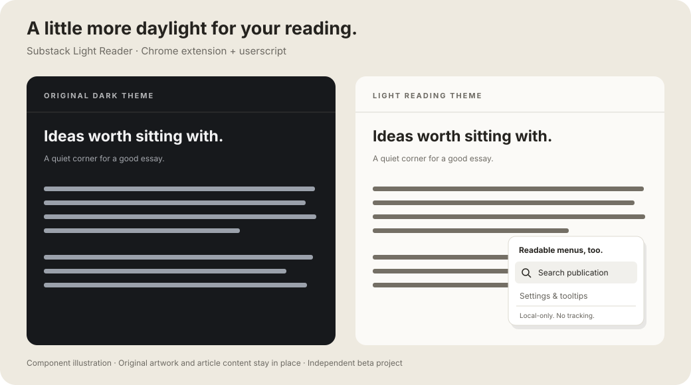

# Substack Light Reader

Give dark Substack publications a light reading background in Chrome. This repository contains the Chrome extension, Tampermonkey userscript, and the English/Chinese product website.

[简体中文](README.zh-CN.md) · [Privacy](PRIVACY.md) · [Changelog](CHANGELOG.md) · [Website development](website/README.md)

Extension `0.5.0` · userscript `2.1.0` · manual installation. Not yet available in the Chrome Web Store.



*Local component illustration, not a screenshot of a live publication.*

## What it does

- Detects dark reading pages and applies a light background with dark text. Pages that already look light are left unchanged.
- Adjusts navigation icons, tooltips, menus, inputs, and other reading controls, as well as article text.
- Supports publication reading pages on `*.substack.com` and the custom domains listed below.
- Provides a global on/off switch in the extension popup. The userscript can be turned off in Tampermonkey.
- Runs locally, without a backend or analytics.

This is an independent project, not affiliated with or endorsed by Substack. It changes presentation only; it does not unlock paid content.

## Install

Choose **one** version. Running both at once can make theme problems harder to diagnose.

### Chrome extension

1. Open this repository's **Releases** section and download `substack-light-reader-v0.5.0.zip` (or the newer extension ZIP).
2. Extract the ZIP into a folder you will keep on your computer.
3. Open `chrome://extensions/` in Chrome and enable **Developer mode**.
4. Click **Load unpacked** and select the extracted folder containing `manifest.json`.
5. Refresh a supported publication page. Pin the extension if you want quick access to its switch.

The switch applies to all supported sites. It enables automatic dark-page detection; it does not force already-light pages to change.

If there is no release yet, choose **Code → Download ZIP** on the repository page, extract it, and load its `extension/` folder. The generated extension is included in the repository, so installing this way does not require Node.js or a build step.

To update, download the new ZIP, replace the files in the folder you originally loaded, click **Reload** on the extension's card, and refresh the page. **Unpacked extensions do not receive automatic Chrome Web Store updates.** Keep the installed folder in place.

### Tampermonkey userscript

1. Install Tampermonkey for Chrome if you do not already have it.
2. Download `substack-light-reader-v2.1.0.user.js` (or the newer `.user.js` file) from this repository's **Releases** section. Before a release exists, use `userscript/substack-light-reader.user.js` from a downloaded copy of the repository.
3. In Tampermonkey, choose **Create a new script**, replace the template with the downloaded file's contents, and save.
4. Follow any script-execution setup prompts shown by Tampermonkey, then refresh the page.

To update an existing installation, replace its contents rather than creating another enabled copy. Updates are manual in this initial release.

The script retains the old name **Art & Biz Substack 亮色阅读模式** and namespace `local.artandbiz.light` so existing users can identify and update it. It now supports the broader site list below.

## Supported pages

The scope is publication reading pages, including article pages, publication home pages, and archives. The Substack main site, publishing dashboards, editors, sign-in pages, payment flows, and account settings are excluded.

Standard publication domains under `*.substack.com` are supported. These custom domains are also included:

| Publication | Domain |
| --- | --- |
| future/proof — Dan Koe | `letters.thedankoe.com` |
| Lenny's Newsletter | `www.lennysnewsletter.com` |
| Noahpinion | `www.noahpinion.blog` |
| SemiAnalysis | `newsletter.semianalysis.com` |
| The Pragmatic Engineer | `newsletter.pragmaticengineer.com` |
| ByteByteGo | `blog.bytebytego.com` |
| Exponential View | `www.exponentialview.co` |
| Product Growth | `www.news.aakashg.com` |
| Newcomer | `www.newcomer.co` |
| The Generalist | `www.generalist.com` |
| Citrini Research | `www.citriniresearch.com` |
| Doomberg | `newsletter.doomberg.com` |
| Blocked and Reported | `www.blockedandreported.org` |

This is a bundled allowlist, not a live ranking or automatic discovery of every custom domain. Being listed means the code may run there; it does not mean every page and theme has been visually verified. A custom domain not listed here needs to be added to the configuration in a later release.

## Limits and feedback

This beta grew out of testing Art & Biz and Dan Koe's publications. The tooltip and menu fixes were checked with local component fixtures, and the initial user confirmed the revised theme worked in their browser. That does not cover every logged-in menu, publication layout, or future Substack update. Other browsers have not been verified.

Images, video, and publication logos keep their original artwork. Dark images remain dark. Some embedded content or unusual brand styling may need an additional fix, and the original theme may appear briefly while a page loads.

If something is unreadable, disable the theme and open an issue with the public page URL, your version, and a cropped screenshot. Remove account details, private messages, and paid article content before sharing. See [Contributing](CONTRIBUTING.md).

## Privacy and permissions

The extension reads page structure and computed colors on supported sites to decide whether to apply its theme. It stores only the global `enabled` preference in `chrome.storage.local`. The userscript does not add a separate preference store.

No analytics, cookies, account data collection, article uploads, or extension-initiated network requests. Site access is limited to the declared supported domains; page exclusions additionally prevent theme activation in non-reading areas. Full details are in [PRIVACY.md](PRIVACY.md).

## Develop

Requirements: **Node.js 22 or newer**, npm, and a `zip` command available on your system. The extension and userscript have no npm runtime dependencies. The website has its own dependencies and lockfile.

```sh
npm run build
npm test
npm run check
```

After building, load `extension/` in Chrome or install `userscript/substack-light-reader.user.js`. Release packages are generated in `dist/`.

| Path | Purpose |
| --- | --- |
| `src/runtime.js` | Shared page scope and theme detection |
| `src/light-theme.css` | Shared light-theme styles |
| `src/extension/` | Extension entry points and popup |
| `src/userscript/` | Userscript entry point |
| `config/sites.json` | Supported custom domains |
| `extension/`, `userscript/` | Generated installable files |
| `dist/` | Generated release packages |
| `website/` | English/Chinese product website, installation guides and downloads |

Edit source and configuration files, then rebuild. Do not maintain separate copies of the theme in the generated extension and userscript. See [CONTRIBUTING.md](CONTRIBUTING.md) for checks before submitting a change.

Commit the generated `extension/` and `userscript/` files with their source changes. `dist/` is ignored by Git; upload its packages and `SHA256SUMS.txt` as release assets. See the [publishing checklist (中文)](docs/PUBLISHING.zh-CN.md) for the initial GitHub push and release steps.

## Website and contact

The website source lives in [`website/`](website/README.md). Its configured public domain is `substacklight.com`; website hosting is a separate step from publishing this repository.

- Email: [support@substacklight.com](mailto:support@substacklight.com)
- Creator: [@taylor_xiao2233 on X](https://x.com/taylor_xiao2233)
- Compatibility reports: this repository’s Issues section

## License

[MIT](LICENSE). Substack and publication names belong to their respective owners.
