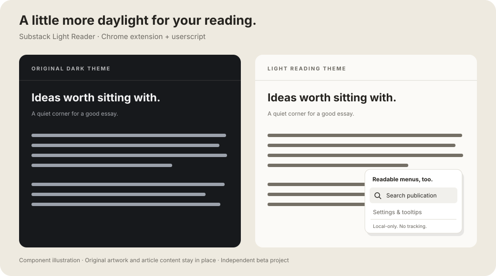

# Substack Light Reader

把暗色 Substack 出版物转成亮底深色文字，方便在 Chrome 中阅读。本仓库包含 Chrome 扩展、Tampermonkey（油猴）脚本，以及中英文官网。

[English](README.md) · [隐私说明](PRIVACY.md) · [更新记录](CHANGELOG.md) · [官网开发说明](website/README.md)

扩展 `0.5.0` · 油猴 `2.1.0` · 手动安装。目前尚未上架 Chrome 商店。



*本地组件示意图，并非真实出版物页面截图。*

## 功能

- 检测暗色阅读页面并转换为亮色；原本就是亮色的页面保持原样。
- 同时调整正文、导航图标、悬浮提示、菜单、输入框等阅读界面元素。
- 支持 `*.substack.com` 出版物阅读页，以及下面列出的自定义域名。
- 扩展弹窗提供全局开关；油猴版可在 Tampermonkey 中关闭。
- 本地运行，无服务器、无访问统计。

这是独立项目，与 Substack 无隶属或官方合作关系。工具只改变页面显示，不会解锁付费内容。

## 安装

**扩展和油猴选择一种即可。** 同时启用两种，会让样式问题更难排查。

### Chrome 扩展

1. 打开本仓库右侧的 **Releases**，下载 `substack-light-reader-v0.5.0.zip`（或新版扩展 ZIP）。
2. 解压到一个准备长期保留的文件夹。
3. Chrome 打开 `chrome://extensions/`，开启右上角的“开发者模式”。
4. 点击“加载已解压的扩展程序”，选择包含 `manifest.json` 的文件夹。
5. 刷新支持的出版物页面。需要方便切换时，可将扩展固定到工具栏。

开关对所有支持的站点统一生效。开启表示“自动识别暗色页面”，不会强制改变原本就亮色的页面。

如果尚未发布 Release，也可以在仓库页面选择 **Code → Download ZIP**，解压后加载其中的 `extension/` 文件夹。仓库已包含构建好的扩展，使用这种方法安装不需要 Node.js，也不需要自己构建。

更新时，下载新版 ZIP，替换最初加载的文件夹内的文件，然后在扩展管理页点击“重新加载”，再刷新网页。**这种本地加载方式不会收到 Chrome 商店自动更新。** 安装后请保留该文件夹。

### Tampermonkey（油猴）

1. 如果尚未安装，先为 Chrome 安装 Tampermonkey。
2. 从本仓库 **Releases** 下载 `substack-light-reader-v2.1.0.user.js`（或新版 `.user.js`）。尚无 Release 时，可使用下载的仓库里的 `userscript/substack-light-reader.user.js`。
3. 在 Tampermonkey 中点击“添加新脚本”，删除默认内容，粘贴下载文件的全部内容并保存。
4. 如 Tampermonkey 显示脚本运行设置提示，按提示完成设置，再刷新网页。

已有旧版脚本时，直接替换原脚本内容，避免同时启用多个版本。这个初始发布版需要手动更新。

为了便于旧用户识别和升级，脚本保留旧名称 **Art & Biz Substack 亮色阅读模式** 和 namespace `local.artandbiz.light`；实际支持范围已扩大到下方名单。

## 支持范围

面向出版物阅读界面，包括文章、出版物首页和归档页。跳过 Substack 主站、作者后台、编辑器、登录页、支付流程和账户设置。

支持 `*.substack.com` 下的出版物域名，并内置以下自定义域名：

| 出版物 | 域名 |
| --- | --- |
| future/proof — Dan Koe | `letters.thedankoe.com` |
| Lenny's Newsletter | `www.lennysnewsletter.com` |
| Noahpinion | `www.noahpinion.blog` |
| SemiAnalysis | `newsletter.semianalysis.com` |
| The Pragmatic Engineer | `newsletter.pragmaticengineer.com` |
| ByteByteGo | `blog.bytebytego.com` |
| Exponential View | `www.exponentialview.co` |
| Product Growth | `www.news.aakashg.com` |
| Newcomer | `www.newcomer.co` |
| The Generalist | `www.generalist.com` |
| Citrini Research | `www.citriniresearch.com` |
| Doomberg | `newsletter.doomberg.com` |
| Blocked and Reported | `www.blockedandreported.org` |

这是内置支持名单，不是实时排行榜，也不会自动发现所有自定义域名。列入名单表示允许代码运行，不代表每个页面和主题都已完成视觉验证。尚未列出的自定义域名，需要修改配置并发布新版后才能支持。

## 已知限制与反馈

这个测试版从 Art & Biz 和 Dan Koe 两个出版物的适配开始。提示框和菜单修复使用本地组件页面检查过，最初的用户也已确认修订后的主题在自己的浏览器中可以使用。验证尚未覆盖所有登录菜单、出版物布局或未来的 Substack 改版；其他浏览器也未经验证。

图片、视频和出版物标志保留原始画面，暗色图片不会变成亮色。嵌入内容或特殊品牌样式可能还需要修复；页面加载时也可能短暂出现原始主题。

如遇到文字或图标看不清，可以先关闭主题，再提交 Issue，附公开页面网址、版本号和局部截图。请去掉账户信息、私信和付费正文，详情见[贡献说明](CONTRIBUTING.md)。

## 隐私与权限

扩展在支持的站点上读取页面结构和计算后的颜色，以决定是否启用主题。只在 `chrome.storage.local` 保存全局开关 `enabled`。油猴脚本不额外存储偏好。

没有访问统计，不读取 Cookie，不收集账户资料，不上传正文，也不主动发起网络请求。网站访问范围限定为声明的支持域名；页面排除规则进一步阻止在非阅读区域启用主题。完整说明见 [PRIVACY.md](PRIVACY.md)。

## 本地开发

需要 **Node.js 22 或更高版本**、npm，以及系统可用的 `zip` 命令。扩展和脚本没有 npm 运行依赖；官网有独立的依赖和锁文件。

```sh
npm run build
npm test
npm run check
```

构建后，可在 Chrome 中加载 `extension/`，或安装 `userscript/substack-light-reader.user.js`；用于发布的包生成在 `dist/`。

| 路径 | 内容 |
| --- | --- |
| `src/runtime.js` | 共用的页面范围判断与主题检测 |
| `src/light-theme.css` | 共用亮色样式 |
| `src/extension/` | 扩展入口及弹窗 |
| `src/userscript/` | 油猴入口 |
| `config/sites.json` | 支持的自定义域名 |
| `extension/`、`userscript/` | 自动生成的可安装文件 |
| `dist/` | 自动生成的发布包 |
| `website/` | 中英文官网、安装指南和下载文件 |

修改源码或配置后重新构建，不要分别维护生成的扩展与油猴样式。提交前的检查方法见 [CONTRIBUTING.md](CONTRIBUTING.md)。

生成的 `extension/` 和 `userscript/` 应随源码一起提交。`dist/` 已被 Git 忽略，其中的安装包和 `SHA256SUMS.txt` 用于上传为 Release 附件。第一次推送 GitHub 和发布 Release 的步骤见[发布清单](docs/PUBLISHING.zh-CN.md)。

## 官网与联系

官网源码位于 [`website/`](website/README.md)，正式域名配置为 `substacklight.com`。把代码上传到 GitHub 不会自动完成网站部署。

- 邮箱：[support@substacklight.com](mailto:support@substacklight.com)
- 开发者：[@taylor_xiao2233](https://x.com/taylor_xiao2233)
- 兼容性问题：本仓库的 Issues

## 许可证

[MIT](LICENSE)。Substack 及各出版物名称归其相应权利人所有。
